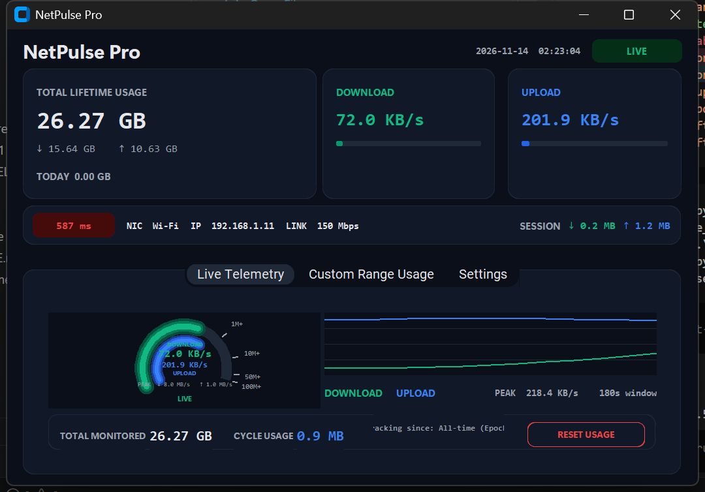

<div align="center">

# ⚡ NetPulse Pro

### Precision network telemetry for Windows — a 220° glowing speedometer, live throughput analytics and a non-destructive usage cycle tracker.

[](https://github.com/Qasimi1995/NetPulse-Pro/releases/latest)
[](https://www.microsoft.com/windows)
[](https://www.python.org)
[](LICENSE)

**[⬇ Download Latest Release](https://github.com/Qasimi1995/NetPulse-Pro/releases/latest)** &nbsp;·&nbsp;
[Features](#-features) &nbsp;·&nbsp; [Installation](#-installation) &nbsp;·&nbsp; [Building](#-building-from-source) &nbsp;·&nbsp; [Changelog](CHANGELOG.md)


*The Live Telemetry tab: 220° dual-arc speedometer, rolling throughput graph and cycle banner.*

</div>

---

## ✨ Features

### 🎛️ 220° Dual-Arc Speedometer Gauge

The centrepiece is a fully custom-drawn canvas instrument — no charting library.

- A **220° dark obsidian track** (`#1F2937`) with a 140° gap at the bottom.
- A **glowing Electric Emerald arc** (`#10B981`) for download throughput, drawn as
  three layered strokes for a soft neon falloff.
- A **secondary Sapphire inner ring** (`#3B82F6`) for upload throughput, so both
  directions are readable at a glance.
- **Logarithmic auto-ranging** — the scale floor is 100 Mbps and the ceiling
  doubles automatically (up to **10 Gbps**) when the needle exceeds 92 % of the
  current range. Tick marks read `0`, `1M+`, `10M+`, `50M+`, `100M+`, so a 40
  KB/s browse and a 700 MB/s transfer both animate smoothly instead of pegging.
- Crisp **monospaced digital readouts**, session **peak download / upload**, and
  a live status indicator.

### 📡 Live Telemetry with Cycle Start Tracking

- A **live ticking clock** in the header (`2026-11-12 | 14:32:08`) updated every
  second without disturbing the 2-second polling worker.
- **Cycle start tracking**: the statistics banner always shows exactly when the
  current usage cycle began — `Tracking since: Nov 12, 2026 09:15 AM` — or
  `Tracking since: All-time (Epoch)` if no reset has been performed.

### ♻️ Non-Destructive Usage Resets

`RESET USAGE` never deletes a single record. It writes a **UTC baseline
timestamp** to `settings.json` and restarts the counters:

| Metric | Behaviour |
| --- | --- |
| `TOTAL MONITORED` | Bytes recorded at/after the baseline |
| `CYCLE USAGE` | Bytes since the application was launched |
| Range analytics | **Unaffected** — full history preserved |
| CSV export | **Unaffected** — full history preserved |

### 📊 Range Analytics & CSV Export

Preset ranges (**Today**, **Last 7 Days**, **This Month**) or any custom
`YYYY-MM-DD [HH:MM:SS]` window, with dedicated **Downloaded / Uploaded / Total
Transferred** result cards and a one-click **Export to CSV** button.

### 🖥️ High-DPI System Tray & Glassmorphic UI

- Dark obsidian theme (`#0B0F19`) with `#111827` glass cards and `#1F2937`
  borders on 12 px radii.
- **Close-to-tray** with smooth double-click restore; tray menu offers
  Show Dashboard / Start / Stop / Exit.
- Deterministic **150 % DPI** scaling on Windows 10/11, plus an in-app
  **interface zoom** slider.

---

## 🚀 Installation

### Option 1 — One-click `.exe` (recommended)

1. Go to the **[latest release](https://github.com/Qasimi1995/NetPulse-Pro/releases/latest)**.
2. Download **`NetPulse Pro.exe`**.
3. Double-click to run. No installer, no Python, no administrator rights.

The executable is fully self-contained (PyInstaller onefile) and stores its
database and settings under `%LOCALAPPDATA%\NetPulse Pro\`.

### Option 2 — Run from source

```powershell
git clone https://github.com/Qasimi1995/NetPulse-Pro.git
cd NetPulse-Pro
python -m venv .venv
.\.venv\Scripts\Activate.ps1
pip install -r requirements.txt
python main.py
```

---

## 🔨 Building from source

`build.ps1` installs the pinned dependencies and produces a fresh onefile
executable:

```powershell
.\build.ps1
# → dist\NetPulse Pro.exe
```

---

## 📁 Project Structure

```
NetPulse-Pro/
├── core/
│   ├── __init__.py
│   ├── database.py          # SQLite (WAL) schema, queries, CSV export
│   ├── network.py           # NIC polling, TCP ping health, session counters
│   └── settings_manager.py  # JSON settings + Windows startup registry
├── ui/
│   ├── __init__.py
│   ├── dashboard.py         # CustomTkinter dashboard + speedometer gauge
│   └── tray.py              # pystray system-tray integration
├── assets/                  # Screenshots used by the README
├── main.py                  # Entry point, DPI scaling, lifecycle
├── build.ps1                # One-command PyInstaller build
├── requirements.txt
├── CHANGELOG.md
├── LICENSE
└── README.md
```

---

## 🧰 Tech Stack

| Layer | Technology | Purpose |
| --- | --- | --- |
| UI | [CustomTkinter](https://github.com/TomSchimansky/CustomTkinter) 6.x | Dark glassmorphic widgets, DPI-aware scaling |
| Canvas | `tkinter.Canvas` | Hand-drawn 220° speedometer gauge |
| Tray | [pystray](https://github.com/moses-palmer/pystray) + Pillow | System-tray icon and menu |
| Telemetry | [psutil](https://github.com/giampaolo/psutil) | NIC byte counters, interface stats |
| Storage | SQLite 3 (WAL) | Append-only bandwidth records |
| Packaging | [PyInstaller](https://pyinstaller.org/) | Standalone Windows `.exe` |

---

## 📄 License

Released under the [MIT License](LICENSE) — Copyright (c) 2026 Qasimi1995.

<div align="center">

If NetPulse Pro helps you keep an eye on your bandwidth, a ⭐ is greatly appreciated.

</div>
